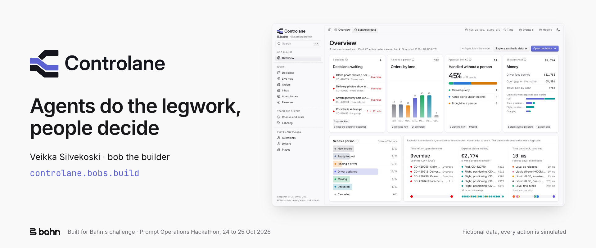

<picture>
  <source media="(prefers-color-scheme: dark)" srcset="docs/header-dark.png">
  
</picture>

# Controlane

**Agents do the legwork, people decide.** Controlane is a control room for
Bahn's car delivery team. Agents read, ask and look things up in the
background. People see only the orders that need them, and make the call.

Live at **https://controlane.bobs.build**. Built solo by Veikka Silvekoski
(bob the builder) for Bahn's challenge at the Prompt Operations Hackathon,
24 to 25 October 2026.

## The problem

Bahn delivered over 25,000 cars this year with about 50 people in operations.
Each problem is simple alone. The chain is the hard part: a sold-out ferry
becomes a new booking, a hotel question, an email and a cost decision. Today
one person holds that chain in their head.

## What it does

- **Stays quiet.** In the snapshot, 75 of 77 active orders are on track and
  the agents handle them. Four decisions need a person. They come first,
  sorted by the time left before a promise breaks.
- **One card per decision.** The question comes first, as a yes or no. Every
  fact shows its source and its age. The card says who approves it.
- **The GPS stop check.** A plain rule finds a long, unplanned stop. The agent
  does the cheap work first: is the signal fresh, what is nearby, what did the
  driver say. Models rank the likely cause. Plain code picks the outcome: log
  it quietly, ask the driver, or bring a person one card.
- **A person approves every change.** The agent can look things up and message
  drivers. A change to a booking, a date, a cost or a customer waits for a
  person. A rejected card becomes a one-tap labeling case, and then an eval.
- **A small model that beats the big one.** `bahnator-1.1-pro-preview` is a
  LoRA fine-tune of Liquid d1-3B. On 203 template families it never saw in
  training, it scores 93.5% against 89.3% for the commercial checker, with
  fewer false alarms and about ten times the speed. The winning run cost
  $1.33 on Verda.

## What is in here

| Folder | What it is |
| --- | --- |
| [`starter/`](starter/README.md) | The main UI (Next.js, port 3000): overview, decisions, orders, live map, inbox, finances, and the pitch deck at `/deck` |
| [`control-room/`](control-room/README.md) | The engine (Next.js, port 3100): the agent, the checks, the evals and the clock. Its JSON API serves the starter |
| [`PRD.md`](PRD.md) | The plan. Every screen traces back to it |
| [`dataset/`](dataset/README.md), `attachments/` | Bahn's fictional packet: 100 orders with drivers, bookings, messages, alerts and files |
| [`deploy/`](deploy/) | Auto deploy to a Verda VM |
| `PARTICIPANT-BRIEF.md`, `OPERATIONS-CONTEXT.md` | Bahn's challenge brief and how delivery work goes |

## Run it

You need Node.js 24 or newer and Docker.

```sh
# The engine
cd control-room && npm ci && cp .env.example .env && npm run dev

# The UI, in a second terminal
cd starter && cp .env.example .env && npm ci
docker compose up -d --wait
npm run db:push && npm run db:seed && npm run attachments:seed
npm run dev
```

Open http://localhost:3000. Without an `ANTHROPIC_API_KEY` in
`control-room/.env`, the agent runs in scripted replay and the UI says so.

## Deploy

Every push to `main` deploys to a Verda CPU VM in Finland. The GitHub Action
copies the repo to the VM and runs [`deploy/remote.sh`](deploy/remote.sh),
which builds both apps and restarts them behind Caddy with HTTPS. To set up a
new VM once, run `deploy/verda-create.sh owner/repo`.
